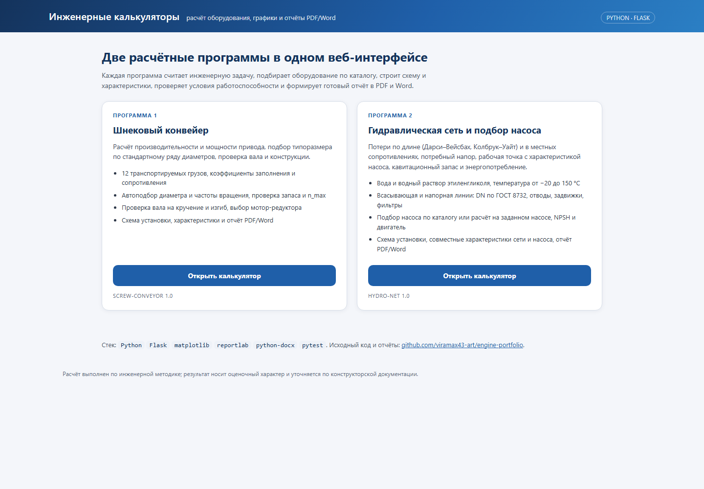
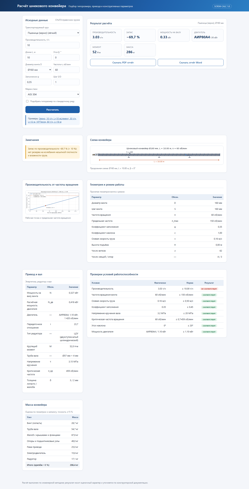
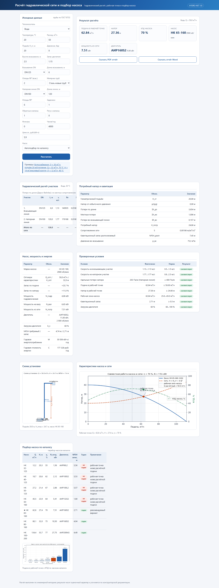

# Инженерный портфолио-проект: два расчётных веб-приложения

Два самостоятельных расчётных приложения на Python с единым набором общих
модулей оформления (PDF, Word, графики, вёрстка HTML):

| Программа | Назначение | CLI | Web |
|---|---|---|---|
| `screw_conveyor` | Расчёт и подбор шнекового конвейера (вал, привод, конструкция) | `python -m screw_conveyor.cli` | `python -m screw_conveyor.web` → http://127.0.0.1:5001 |
| `hydro_net` | Гидравлический расчёт сети и подбор насоса по каталогу | `python -m hydro_net.cli` | `python -m hydro_net.web` → http://127.0.0.1:5002 |

Порты переопределяются переменными окружения `SCREW_PORT` и `HYDRO_PORT`.

## Скриншоты

<p align="center">
  
  
  
</p>

## Структура

```
app.py             общая точка входа: / — портфолио, /screw/ и /hydro/ — калькуляторы
common/            общие модули (не зависят от конкретной программы)
  fmt.py           форматирование чисел и процентов под русскую локаль
  hydraulics.py    свойства жидкостей, скорость, Re, λ (Колбрук–Уайт), потери напора
  plotkit.py       matplotlib: стиль, кириллические шрифты, PNG/схемы
  pdf_kit.py       построение PDF (reportlab): обложка, таблицы, рисунки
  docx_kit.py      построение Word (python-docx) с тем же API, что и PDF
  web_kit.py       карточки, таблицы, KPI, значки, загрузка файлов для Flask
screw_conveyor/    программа 1: core, catalog, charts, report, cli, web, tests
hydro_net/         программа 2: core, catalog, charts, report, cli, web, tests
docs/screenshots/  снимки интерфейсов для портфолио
out/               готовые отчёты (PDF/DOCX), создаются при запуске
Procfile           команда запуска для хостингов (Render, Railway и совместимые)
render.yaml        blueprint бесплатного веб-сервиса Render
Dockerfile         образ для хостингов с Docker (Render, Koyeb, HF Spaces)
```

В каждой программе: `core.py` — расчётное ядро, `catalog.py` — справочники
(материалы, сортамент труб по ГОСТ 8732, коэффициенты ζ, насосы, двигатели),
`charts.py` — схемы и характеристики, `report.py` — сборка PDF/Word,
`cli.py` и `web.py` — интерфейсы, `tests/` — тесты pytest.

## Возможности

Обе программы умеют:

- считать по исходным данным из формы, консоли или демо-примера (`--example 0..2`);
- подбирать оборудование по каталогу и проверять условия работоспособности;
- строить схему установки и графики (насос/сеть, эпюры, характеристики);
- выпускать отчёт в PDF и Word с таблицами, схемой и выводами;
- работать в веб-интерфейсе: расчёт, KPI-карточки, графики, выгрузка отчётов.

`hydro_net` дополнительно: режим «автоподбор по каталогу» или расчёт на
фиксированном насосе, проверка NPSH, КПД и загрузки двигателя, годовые
энергозатраты.

## Установка

```powershell
python -m pip install -r requirements.txt
```

## Запуск

```powershell
# консоль: демо-пример с выгрузкой отчётов
python -m hydro_net.cli --example 0 --pdf out/hydro_ex0.pdf --docx out/hydro_ex0.docx
python -m screw_conveyor.cli --example 0 --pdf out/screw_report.pdf --docx out/screw_report.docx

# расчёт по своим данным (пример)
python -m hydro_net.cli --flow 40 --static 18 --length 90 --dn 100 --pdf out/net.pdf
python -m screw_conveyor.cli --capacity 33 --length 24 --diameter 320 --pdf out/screw.pdf

# веб-интерфейс
python -m hydro_net.web        # http://127.0.0.1:5002
python -m screw_conveyor.web   # http://127.0.0.1:5001

# оба калькулятора одним приложением (как на хостинге)
python app.py                  # http://127.0.0.1:8000 → / , /screw/ , /hydro/
```

`app.py` собирает оба Flask-приложения в один WSGI-сервис: `/` — страница-портфолио,
`/screw/` и `/hydro/` — калькуляторы, `/healthz` — проверка живости.

## Публикация на бесплатном хостинге

Репозиторий готов к деплою одним веб-сервисом (Render, бесплатный план):

1. Открыть <https://render.com/deploy?repo=https://github.com/viramax43-art/engine-portfolio>
   и подтвердить создание сервиса из `render.yaml`.
   Вручную: New → Web Service → подключить репозиторий, build `pip install -r requirements.txt`,
   start `gunicorn app:app --bind 0.0.0.0:$PORT --timeout 180 --workers 1 --threads 4`.
2. Через 2–3 минуты сайт доступен по адресу `https://<имя-сервиса>.onrender.com`:
   `/` — портфолио, `/screw/` и `/hydro/` — калькуляторы. Бесплатный инстанс засыпает
   без трафика и просыпается за ~30 с при первом запросе.

Переменные окружения заданы в `render.yaml`: `PYTHON_VERSION=3.12.6`,
`MPLCONFIGDIR=/tmp/mpl`, `OUT_DIR=/tmp/out`, `SCREW_PREFIX=/screw`, `HYDRO_PREFIX=/hydro`.
Тот же репозиторий разворачивается через `Dockerfile` (порт из `PORT`, по умолчанию 7860)
на Koyeb, Hugging Face Spaces и любом Docker-хостинге.

## Тесты

```powershell
python -m pytest -q
```

76 тестов (34 — шнековый конвейер, 42 — гидравлическая сеть): расчётное ядро,
подбор по каталогу, проверочные условия, графики, отчёты, веб-маршруты.

## Демонстрационные примеры

`screw_conveyor`: зерно 10 т/ч, цемент 30 т/ч под углом, песок 60 т/ч —
подбор диаметра, частоты вращения и привода.
`hydro_net`: вода и растворы гликоля, разные диаметры и длины линий —
рабочая точка, потери, NPSH, подбор насоса из каталога.
